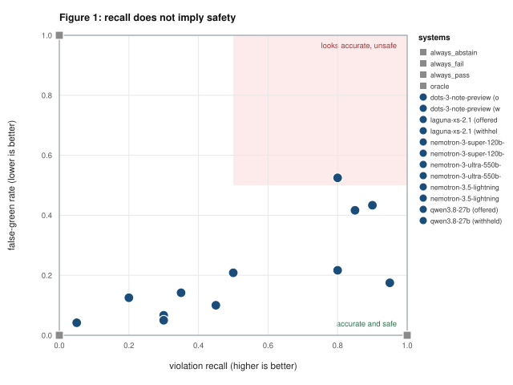

# No False Green: A Benchmark for Evidence-Aware Compliance Verdicts over Structured Employer Records

Diptopal Roy, Settle AI Inc. (diptopal@joinsettle.info). See *Competing interests*, Section 11.

**Status of this draft: complete, for review.** All sections are written. Every table is
generated from retained artifacts by the repository's scripts, and every quantitative
claim in the text is recomputed from those artifacts by
`scripts/verify_paper.py`, which currently confirms 136 of 136. Each methodological rule that could have been chosen after
seeing results (label views, model substitutions, evidence classes, excerpt selection,
label audit, cut-offs) was committed to the repository before the results it governs,
and the paper cites the record.

---

## Abstract

Automated systems increasingly issue machine-generated compliance verdicts in regulated
domains, presenting an organisation's obligations as a dashboard of satisfied and
violated states. The evaluation of such systems measures accuracy on isolated
determinations, which leaves the deployment-critical error unmeasured: reporting an
obligation as *satisfied* when the evidence required to assess it was never present. We
call this a **false green**, and we argue it is categorically worse than a false alarm,
because a false alarm is corrected by review whereas a false green suppresses the review
that would correct it.

We introduce **No False Green**, a benchmark for evidence-aware compliance verdicts over
structured employer records in United States employment-based immigration. An instance is
a synthetic employer: a bundle of source exports paired with a rulebook of 194 citable
obligations across ten regulatory regimes. A system must return one of four verdicts for
each (obligation, entity) pair: `pass`, `fail`, `needs_evidence`, or `unmonitored`.
Ground truth is fixed by construction. A generator selects each pair's disposition first,
then renders source records consistent with that choice, so labels are not annotations of
data but the specification the data was rendered from.

The benchmark inverts the incentive structure of standard evaluation in one specific way:
correct abstention is the **majority class**, at 201 of 221 pairs in the hand-authored
anchor firm and 48.8% of 1,481 pairs across the released set. We report the false-green
rate alongside violation recall, false-alarm rate on planted controls, abstention
precision and recall, and a consistency check between a system's headline counts and its
own per-pair verdicts. Trivial baselines establish that these metrics are not
individually sufficient: a system answering `pass` everywhere attains a 0.000 false-alarm
rate and is indistinguishable from a safe system under accuracy-style scoring, while
scoring 1.000 on the false-green rate; conversely a system abstaining everywhere attains
0.717 abstention F1 while detecting no violations. An evidence-aware oracle attains 1.000
on every axis, establishing that the task is solvable and that low scores reflect the
system under test.

We evaluate six free API models under two output schemas on a 140-pair declared subset.
Offered an explicit abstention, they report 0.042 to 0.142 of unassessable obligations as
satisfied, but detect only 0.050 to 0.450 of violations. With the abstention removed from
the schema, false greens rise three- to fivefold, to 0.175 to 0.525, though prompt, data
and models are unchanged. False greens concentrate where an export carries a populated
column adjacent to the missing evidence, such as a signed date standing in for a signature.
Where nothing adjacent is exported, models raise no false green at all. Because every instance is synthetic, the benchmark is released without the
confidentiality constraints that keep comparable compliance data unpublishable.

---

## 1. Introduction

A compliance dashboard makes a claim about the world with every cell it renders. When a
cell is green, it asserts that a specific legal obligation, attached to a specific worker
or filing, has been assessed and found satisfied. The assertion has a precondition that
the rendering does not express: that the evidence needed to perform the assessment was
present.

When the precondition fails, a system has three options. It can say so. It can decline to
render the cell. Or it can render the cell green. The third option is the one this paper
is about, and it is attractive to build for reasons that have nothing to do with
correctness: a dashboard of mostly-green cells looks like a working product, a mostly-grey
one looks broken, and the customer cannot distinguish "assessed and fine" from
"unassessed" without reading the underlying records themselves, which is the labour the
product exists to remove.

We call the third option a **false green** and make three claims about it.

**It is not symmetric with a false alarm.** A false alarm consumes reviewer time and is
extinguished by the review it triggers. A false green consumes nothing and triggers
nothing. It is self-concealing: the only signal that would surface it is the review that
it suppresses. In immigration compliance specifically, the obligations at issue carry
per-worker civil penalties and the enforcement mechanism is an audit that arrives without
warning, so a false green converts a curable gap into an uncurable finding.

**It is invisible to accuracy.** Violations are a minority class in real compliance data.
A system that answers `pass` on every pair whose evidence is absent therefore scores well
on any metric that averages over pairs, and scores *perfectly* on the compliant cases
that dominate the distribution. Section 8 shows this concretely: our `always_pass`
baseline attains a false-alarm rate of 0.000 across 31 firms.

**It is barely measured.** Benchmarks in legal NLP evaluate reasoning and classification
over regulatory text and case law (Guha et al., 2023). Most abstention benchmarks evaluate
free-text question answering. Recent work has begun to score evidence sufficiency and the
overclaiming direction directly, in retrieval-augmented generation (Joren et al., 2024),
claim verification over databases (Theologitis et al., 2026), and agent governance and
authorisation-limited evidence (Solozobov, 2026; Tallam, 2026). None of it evaluates a
system reading a third-party employer's structured records and deciding, per legal
obligation, whether the records support a verdict at all, in a domain where correct
abstention is the majority class. Section 2 sets out how close each comes.

We make three contributions.

1. **A task.** Verdicts over (obligation, entity) pairs with four states, where
   `needs_evidence` is a first-class output with its own correctness condition rather than
   a refusal to participate (Section 4).
2. **A benchmark.** A hand-authored anchor firm with 221 pinned expectations, a seeded
   generator producing unbounded additional firms with ground truth by construction, and a
   rulebook of 194 obligations each carrying its regulatory citation (Section 5).
3. **A metric suite** centred on the false-green rate, with baselines demonstrating that
   no single metric in the suite is sufficient alone (Sections 6 and 8).

The benchmark is fully synthetic, which is the reason it can exist. Compliance data
describing real employers is subject to attorney-client privilege and employee privacy
obligations that make publication impossible, which is why the gap this benchmark fills
has remained open.

---

## 2. Related work

Several literatures touch this problem. None occupies quite the position this benchmark
takes, but three recent benchmarks come closer than a reader of the introduction might
expect, and we say where. In each case the difference lies in what the system is given,
what it must return, and how the label is established.

**Legal and regulatory NLP benchmarks.** Work in this area evaluates reasoning and
classification over *legal text*. LegalBench assembles 162 tasks spanning six types of
legal reasoning, designed and hand-crafted by legal professionals (Guha et al., 2023).
LexGLUE standardises a collection of legal language-understanding datasets (Chalkidis et
al., 2022); CaseHOLD poses over 53,000 multiple-choice questions identifying the holding
of a cited case (Zheng et al., 2021); CUAD asks models to highlight salient portions
of contracts, with over 13,000 annotations from legal experts (Hendrycks et al., 2021); and
LawBench tests legal knowledge at the levels of memorisation, understanding and
application (Fei et al., 2024). A system is given a legal question or a document and
asked to answer, classify, or retrieve. Our input is an organisation's structured
operational records, and our output is a verdict per obligation about that organisation.
A model that scores well on legal reasoning has demonstrated nothing about whether it
will report an unassessable duty as satisfied, because these tasks do not ask it to
decide whether its evidence base is sufficient.

The legal hallucination literature is closer in motivation. Dahl et al. (2024) find
hallucination rates between 58% and 88% when models are asked verifiable questions about
federal court cases, and report that models cannot always predict when they are
hallucinating. Magesh et al. (2025), in a preregistered evaluation, find that commercial
legal research tools hallucinate less than a general-purpose chatbot but substantially
more than their vendors claim. Both measure unsupported output about the law. We measure
unsupported output about a regulated party, where the support that is missing is a record
rather than a precedent.

**Immigration-specific datasets.** ImmigrationQA provides 17,058 question-answer pairs
generated from United States immigration sources including the USCIS Policy Manual and
8 CFR (Shportun, 2026). ImmigrationReason structures 12,375 non-precedent decisions of the
USCIS Administrative Appeals Office, recording for each the applicable legal framework,
per-criterion evidence-sufficiency findings under a five-category label, and verbatim
adjudicator criticism, including nearly 9,000 instances of legal error identified by the
Office (Afsharrad and Mousavi, 2026). ImmigrationReason is nearer to our task than a
policy-QA dataset, since it labels whether evidence sufficed for a criterion. Its labels,
however, are extracted from the text of adjudications: the sufficiency judgement is the
adjudicator's, made about a petition record that the dataset does not contain. Both
datasets are text-side. Employer-side obligations, where the per-worker civil penalties and
the audit exposure sit, are absent. We are not aware of a public dataset of employer
immigration-compliance records with labelled obligation outcomes, and the reason is
straightforward: real ones cannot be published.

**Compliance benchmarks for AI systems.** Automated compliance checking predates language
models. In construction, regulatory text is converted into machine-checkable rules by
semantic information extraction (Zhang and El-Gohary, 2016); in data protection, privacy
policies are checked for completeness against GDPR provisions (Amaral et al., 2022) and
questioned directly, with expert analysis of which questions a policy can answer at all
(Ravichander et al., 2019). Recent LLM work divides into two directions. In the first, the
AI system is the regulated subject: COMPL-AI translates the EU AI Act into technical
requirements and benchmarks twelve LLMs against them (Guldimann et al., 2024). The
direction of assessment is inverted relative to ours. In the second, the AI system is an
assessor of someone else. HSE-Bench poses over 1,000 IRAC-structured health, safety and
environment compliance questions (Wang et al., 2025). Principle-Bench evaluates LLM judges
of financial promotions against two regulatory principles under a pre-registered rubric
(Sarkar, 2026). ReguSim's monitoring benchmark asks a model to judge a marked record within
a window of trading records, and finds that simple structured baselines match or exceed
prompt-only LLMs (Luo et al., 2026). These share our assessor-side orientation, and the
last shares our record-level input. None of them gives insufficiency of the record its
own correct label.

Two recent benchmarks do, and they are the nearest neighbours of this work. DEMM-Bench
asks whether agent-runtime records (traces, ledgers, policy logs and the like) are
sufficient to reconstruct properties of a specific decision, labels cases with a
construction oracle, and reports an overclaim rate as its primary diagnostic (Solozobov,
2026). Its "container fallacy", treating the presence of an evidence container as
sufficiency, is close to what we call adjacent-field substitution, where a populated column
beside the missing evidence is read as the evidence. Partial Evidence Bench constructs
deterministic synthetic scenarios, including a compliance-audit family, in which material
evidence lies outside an agent's authorisation boundary, and scores *unsafe completeness*:
an answer that appears complete when it is not (Tallam, 2026). It reports that explicit
fail-and-report behaviour removes unsafe completeness without collapsing into trivial
abstention. That is, in substance, our argument that the false-green rate and the
abstention rate must be read together. We differ in three respects. Our subject is a
third-party employer and our output a regulatory verdict per (obligation, entity) pair,
not a governance reconstruction or a retrieval answer; our insufficiency is a property of
what the employer's exports contain, not of what an agent is permitted to see; and our
anchor firm alone spans 221 pairs across ten regimes, and the generator
adds firms at any seed (1,481 pairs over 31 firms in the release, against 64 cases and
72 tasks respectively), which supports per-firm aggregation and intervals. We do not claim the directional, construction-labelled framing
as new; both works reach it independently.

**Abstention and selective prediction.** This is the closest established literature and
deserves the most precision, because a reviewer will reasonably ask what is new.

The reject option goes back to Chow (1970), who characterised the optimal tradeoff between
recognition error and rejection. Selective classification formalises it as a risk-coverage
trade-off (El-Yaniv and Wiener, 2010), and Geifman and El-Yaniv (2017) construct selective
deep classifiers that reject as needed to meet a user-set risk level. In this framing
coverage is a good to be maximised subject to a risk budget, and abstention is a *cost*
incurred to avoid error.

For language models, abstention is evaluated mostly on questions. SQuAD 2.0 adds
unanswerable questions to reading comprehension (Rajpurkar et al., 2018); SelfAware pairs
unanswerable questions with answerable counterparts to measure self-knowledge (Yin et al.,
2023); AbstentionBench aggregates 20 datasets of unknown-answer, underspecified,
false-premise and similar questions, and finds that scaling helps little and that
reasoning fine-tuning degrades abstention by 24% on average (Kirichenko et al., 2025). Wen
et al. (2025) survey the area and organise it by query, model and human values. On the
model side, Kadavath et al. (2022) show that models can be trained to predict whether they
know an answer. The work nearest ours in this line is Joren et al. (2024), who define
whether a retrieved context is *sufficient* to answer a query and find that strong models
often answer incorrectly rather than abstain when it is not. That is a statement about the
evidence base rather than the query, as ours is, though in open-domain retrieval rather
than over an organisation's records. Hallucination benchmarks that measure falsehood
against world knowledge (Lin et al., 2022) or the share of atomic claims supported by a
knowledge source (Min et al., 2023) address a related failure without an abstention
label.

Three things differ here.

First, abstention is not a cost. For 48.8% of pairs in our released set it is the
*correct output*, and it is actionable: `needs_evidence` names a document the firm must
produce. A system that trades abstention for coverage is not moving along a tradeoff
curve, it is producing wrong answers that happen to look like answers.

Second, insufficiency is a property of the evidence base rather than the query, so it is
determinable **by construction**. The generator withholds a required export and the label
follows mechanically. Most abstention benchmarks annotate insufficiency, and annotation of
legal sufficiency is exactly the judgement call that makes such datasets small and
contestable. Joren et al. (2024) and the two benchmarks above are partial exceptions: the
first classifies sufficiency with an autorater, the latter two fix it by construction.

Third, the error is directional in a way the risk-coverage framing does not capture.
Answering `fail` on an undecidable pair is wrong but triggers review. Answering `pass` is
wrong and *suppresses* review. Aggregating both into a single risk term hides the only
distinction that matters operationally, which is why we report the false-green rate as a
separate quantity rather than as one minus abstention recall.

**Reasoning over structured and tabular data.** Table-based fact verification asks whether
a statement is entailed or refuted by a table (Chen et al., 2020), and text-to-SQL asks a
system to answer questions over relational databases (Yu et al., 2018). Both originally
assumed that every item could be decided. The three-way label of FEVER, with Supported,
Refuted and NotEnoughInfo assigned by annotators (Thorne et al., 2018), is the nearest
label structure to `pass`, `fail` and `needs_evidence`; FEVEROUS extends it to evidence in
table cells (Aly et al., 2021). Unanswerable questions over structured data appear in
EHRSQL, a text-to-SQL benchmark over electronic health records (Lee et al., 2022), in work
categorising ambiguous and unanswerable text-to-SQL questions (Wang et al., 2023), and in
TrustSQL, which scores abstention on infeasible questions with penalties for incorrect
output (Lee et al., 2024). ClaimDB is the closest: claims verified against real
multi-table databases, with a not-enough-info class, and a finding that both open and
closed models struggle to abstain when there is no evidence to decide (Theologitis et al.,
2026). Our setting shares the structured input and the insufficiency class. It differs in
that the item to be decided is a regulatory obligation attached to an entity rather than a
natural-language claim or question, in that labels are fixed by a generator rather than
annotated or derived from real databases, and in that the two wrong answers on an
undecidable item are scored asymmetrically.

**Output format and schema constraints.** Our schema ablation removes one permitted
verdict and leaves everything else fixed. Related work shows that output constraints
change model answers. Tam et al. (2024) find that restricting generation to structured
formats degrades reasoning, more so as constraints tighten. Röttger et al. (2024) show that
models forced into a multiple-choice format give substantively different answers from those
they give unforced, and that the answers depend on how they are forced. Sclar et al. (2024)
report swings of up to 76 accuracy points from meaning-preserving changes to prompt format,
which is one reason our prompt is frozen and identical across conditions. Closest in
argument is Kalai et al. (2025), who attribute persistent hallucination partly to grading
that gives no credit for expressing uncertainty, so that guessing improves scores, and
propose changing how existing benchmarks are scored. Our ablation is an instance of the
same incentive located in a product interface rather than a leaderboard: a schema with no
state for "could not tell" forces a guess, and some guesses are green. We are not aware of
prior work that measures the effect of removing the abstention label alone on a
directional error rate.

**Aggregate consistency.** We searched for prior work measuring whether a system's reported
headline counts agree with its own per-item outputs and did not find any. We include it as
a metric because we have observed the failure in deployed compliance dashboards, where a
card and its drilldown disagree; we flag it as the least-established axis in the suite.

**Positioning, stated plainly.** The contribution is not a new abstention algorithm and
not a theoretical result. Nor is it the first benchmark to fix evidence insufficiency by
construction or to score the overclaiming direction separately: DEMM-Bench and Partial
Evidence Bench do both, in agent governance and authorisation-limited retrieval. What this
benchmark adds is a task in which correct abstention is the majority class and the
assessed party is a third-party employer described by structured exports; an instrument
for the directional error in that setting, together with an ablation that isolates how
much of it is produced by the output schema; and a releasable artifact in a domain where
releasability is the binding constraint. Ground truth by construction has precedent in
synthetic task suites such as bAbI (Weston et al., 2015); here it also means fresh firms
can be drawn at any seed, which addresses the per-benchmark contamination concern raised
by Sainz et al. (2023). Constructed labels are not error-free, and test-set label errors
can change model rankings (Northcutt et al., 2021), which is why we audit the withheld
labels (Section 6). The release follows datasheet practice (Gebru et al., 2021), and our
reporting requirement, that the false-green rate always appear beside violation recall, is
in the spirit of model cards (Mitchell et al., 2019). Section 10 states what this does not
establish.

---

## 3. Background: the four states

The four-state vocabulary is not a design choice we made for the benchmark. It is forced
by the professional-responsibility constraints on any system that reports on legal
obligations without being counsel, and it was arrived at in a deployed product before it
was formalised here.

**`pass`.** A rule was evaluated against present evidence and the evidence satisfies it.
The claim must be time-bound, because a pass is only as current as the last data import.

**`fail`.** A rule was evaluated against present evidence and the evidence violates it.
The claim must be framed as a potential issue requiring review rather than as a legal
conclusion, because characterising conduct as unlawful is an act of legal judgement.

**`needs_evidence`.** The rule could not be evaluated because a required input is absent.
This is the state that most often collapses in practice, and the collapse has a direction:
a file that was never provided is reported as a file that is in order. The two are
opposite. A not-provided document is an **open gap** that counts against audit readiness.

**`unmonitored`.** The obligation is not assessable from this class of source data at all.
An employer export cannot evidence whether an adverse action was taken against a worker
while a contested tentative nonconfirmation was pending, because that fact lives in
conduct and not in a record the employer exports. Such an obligation must remain visible
as unmonitored. Silent omission is itself a false green.

The distinction between `needs_evidence` and `unmonitored` matters operationally: the
first is actionable by the firm (provide the document), the second is not (no document
exists to provide), and conflating them either sends firms on impossible errands or hides
real gaps.

---

## 4. The task

An instance is a firm $F = (S, E, R, a)$ where $S$ is a set of source exports, $E$ a set
of entities, $R$ a rulebook, and $a$ a pinned evaluation date.

An **entity** $e \in E$ has a type: `worker`, `lca`, `worksite`, `wage_cohort`, or
`employer`. Entity type matters because obligations attach at different granularities: an
I-9 timeliness duty attaches to a worker, a wage-floor duty to a filing, a prevailing-wage
comparison to a cohort defined by occupation, level, and location, and a site-visit
readiness duty to the employer as a whole.

An **obligation** $r \in R$ carries a regulatory citation, the entity type it attaches to,
and a set $\mathrm{req}(r)$ of source fields that must be present for the obligation to be
decidable. This last component is what makes `needs_evidence` computable rather than a
judgement call: if a field in $\mathrm{req}(r)$ is absent from $S$ for entity $e$, the pair
is not decidable, and any verdict other than `needs_evidence` is wrong regardless of
whether the underlying situation happens to be compliant.

A **pair** is $(r, e)$ where $e$'s type matches $r$'s attachment. The prediction target is
a verdict $v \in \{\texttt{pass}, \texttt{fail}, \texttt{needs\_evidence},
\texttt{unmonitored}\}$, optionally with evidence pointers and a citation.

All date-relative obligations evaluate against $a$ rather than against the current date, so
planted expiry windows remain valid indefinitely. The anchor firm pins $a$ = 2026-06-29.

**Scoring rule.** A pair with no prediction is counted as an error rather than skipped. A
system cannot raise its score by declining to answer the pairs it finds hard. This is
enforced in the harness and tested.

---

## 5. Benchmark construction

### 5.1 The rulebook

The rulebook contains 194 obligations across ten regimes: I-9 and E-Verify (28), Labor
Condition Application (23), Public Access File (15), wage and prevailing wage (21), H-1B
status (16), I-129 supplement (13), L-1 (21), F-1 OPT and STEM OPT (15), site-visit
readiness (14), and cross-cutting deadlines and penalties (28). The source manifest lists
196 entries; two rules appear deliberately in two regimes, once as a field check and once
as a deadline clock, and are counted once here under I-9.

Each obligation carries the check it performs, its threshold, its regulatory citation, and
a description of the information needed to decide it. The citations had previously been
through a verification pass in which incorrect citations and thresholds were corrected
inline against primary sources. The rulebook is built programmatically from the source
engine's machine-readable registry of that manifest rather than retyped, so every citation
is traceable to a source document rather than to our recollection.

The anchor firm's expectation set also refers to 17 rules by the engine's internal
identifiers rather than manifest identifiers. Fourteen map to the manifest rule stating the
same duty through the engine's own published alias table. Three are engine roll-ups whose
definitions are assembled from the manifest rules they aggregate and carry those rules'
citations. No obligation text in the benchmark is written from scratch.

### 5.2 The anchor firm

The anchor firm is a synthetic employer of twelve workers, nine on H-1B status and three
United States citizens, operating from two worksites, with eleven source exports totalling
93 data rows: HR roster, case-management export, certified LCAs, I-9 records, E-Verify
cases, payroll register, RFE and NOID cases, cap cases, green-card cases, PERM recruitment
tracker, and benefits census.

Each worker exercises one planted regulatory mechanism. The design is one clean plant per
persona so that a missed finding localises to a mechanism rather than to an interaction.
Representative plants:

| Mechanism | Planted signal |
|---|---|
| I-9 Section 2 timeliness | Section 2 completed 8 business days after start, against a 3-day limit |
| Reverification deadline | List A document expiring 14 days after the pinned date |
| E-Verify TNC window | Notice delivered, no employee decision recorded, well past the response window |
| LCA expiration | Certified period ending 4 days after the pinned date |
| Required wage, greater-of | Salary equals the certified rate but falls below the prevailing wage |
| Material change, occupation | Filing carries an individual-contributor occupation code against a management title |
| Material change, worksite | Roster location differs from the filing's stated area of intended employment |
| Petition expiry | Validity ending 21 days after the pinned date |

The firm also carries **clean controls**: one H-1B worker whose records conform on every
dimension, and three United States citizens outside H-1B scope. A finding on a control is
a false alarm the harness scores.

Its expectation set contains 221 pairs: 20 planted violations and 201 evidence requests.
The 201 arise because most obligations in this domain require evidence an employer export
does not contain. A certified LCA does not evidence that the required notice was posted; a
roster does not evidence which document a worker presented. The honest output for such a
pair is an evidence request, and the fact that these outnumber confirmed violations
tenfold is the empirical claim underlying the benchmark's design.

### 5.3 The generator

The anchor firm is one employer, too small to support an interval on any system's error
rate and lacking conforming controls. The generator addresses both, over a deliberately
narrow set of rules.

Its central property is that **labels precede data**. For each applicable (obligation,
entity) pair the generator first draws a disposition and then writes records that decide
it:

- `planted_violation`: the records show the breach;
- `planted_control`: the records show conformity, with a configured share placed exactly on
  the legal boundary (near-miss controls) to test whether a system flags on proximity rather
  than on the rule;
- `withheld_evidence`: the export that would carry the required information is not provided
  to the firm at all.

The generator emits a pair only for the four rule families whose every listed input it
renders: I-9 Section 1 timeliness (signed on or before the first day of employment, not
before offer acceptance), I-9 Section 2 timeliness (within three business days, weekends and
federal holidays with their observed dates excluded), reverification on or before the
expiry of temporary work authorisation, and the LCA required wage (wages paid at least the
greater of the prevailing wage and the employer's actual wage for similar workers, from a
semimonthly payroll register and an actual-wage table). Each rule is applied only to
entities it governs. Near-miss controls sit on the boundary: Section 1 on the first day,
Section 2 on business day three, Supplement B on the expiry date, pay exactly equal to the
required wage.

Evidence is withheld a whole export at a time, never by blanking one worker's cell. A blank
date for a past deadline reads to a practitioner as "not done", which is a violation, not
missing evidence. A firm either provides its I-9 export, and every I-9 pair is decidable, or
does not, and every I-9 pair is `needs_evidence`.

**An earlier generator failed this standard, and we replaced it.** A first version emitted a
label for every (obligation, entity) pair in the 194-obligation rulebook but rendered
deciding data for only four rule families, and applied rules to entities they cannot govern
(L-1 and OPT rules to H-1B workers). A blind consistency check caught this before any
language-model result on generated firms was reported. An independent labeller, given only
the records and the rule text for 60 stratified pairs, agreed with its labels on 8. Every
figure from that version, including a released-set size of 58,961 pairs and the trivial
baselines computed on it in an earlier draft, is withdrawn; the artifacts are archived in
`docs/study2_v1_invalid/`. The same check on the current generator, on 60 pairs from seeds
not otherwise used, agreed on all 60 (15 per stratum). The test suite now checks every
rendered record against its label across 40 seeds.

The cost of this design is breadth. The generated firms test four rule families thoroughly,
including the boundary cases, while the anchor firm's breadth (221 pairs across ten regimes)
comes from hand authoring. Generation is deterministic in the seed, which the test suite
asserts.

### 5.4 Released scale

| | Value |
|---|---|
| Firms | 31 (1 anchor + 30 generated at seeds 1-30) |
| Pairs | 1,481 |
| Withheld-evidence pairs | 723 (48.8%) |
| Planted violations | 238 |
| Obligations in the rulebook | 194 (the generator renders four rule families) |

Additional firms are available at any seed.

---

## 6. Metrics

Let $T$ be ground truth and $P$ predictions over pairs.

**Violation recall.** Of pairs labelled `fail`, the share predicted `fail`. A missed
violation is the failure the domain treats as unforgivable, so this is reported first.

**Violation precision** and **false-alarm rate.** Precision over `fail` predictions, and
separately the share of `planted_control` pairs on which a system raised any alarm. The
second is reported separately because controls are the pairs where a false alarm is
unambiguously an error.

**False-green rate.** The headline metric:

$$\mathrm{FGR} = \frac{|\{p : T(p) = \texttt{needs\_evidence} \wedge P(p) = \texttt{pass}\}|}{|\{p : T(p) = \texttt{needs\_evidence}\}|}$$

The share of undecidable pairs a system reports as satisfied. Note what it is not: it is
not one minus abstention recall. A system that answers `fail` on an undecidable pair is
wrong, but it is wrong in a direction that triggers review. Only `pass` suppresses review,
so only `pass` counts here.

**Abstention precision and recall,** treating `needs_evidence` as a class. Precision
matters because a system can drive the false-green rate to zero by abstaining everywhere,
which the baselines demonstrate.

**Evidence-pointer accuracy.** Among pairs a system got right and for which ground truth
records the relevant fields, the share where the system's cited evidence intersects them.
A correct verdict reached by citing the wrong record is not a reliable verdict.

**Consistency drift.** Mean absolute relative disagreement between the counts a system
displays for a surface and the per-pair verdicts the same system emitted. A card reading
twelve above a drilldown returning three is internally inconsistent regardless of which
number is correct. This axis exists because we have observed the failure in deployed
dashboards and are not aware of it being measured elsewhere.

**Reporting requirement.** The false-green rate must be reported alongside violation
recall. Neither is meaningful alone, and Section 8 shows why.

---

**Two label views, declared before any main-run result was read.** The anchor firm's
labels were written as the acceptance gate for a compliance engine, where `fail` means
"requires action". This benchmark's `fail` means "the records show a violation". Ten of
the 20 planted violations sit between those meanings, so we score under two views, fixed
in `nofalsegreen/labelviews.py` on 2026-09-24 with each affected pair named by identifier.

- **Engine view, the headline.** The labels as authored. It is the headline because it
  existed before this benchmark did, so nothing decided here can have tuned it.
- **Strict view.** Five "actual-wage memo missing" violations become `needs_evidence`: no
  export records the memo as absent, the evidence is simply not there, which is this
  benchmark's own definition of an evidence request. Five deadlines that had not yet
  passed on the evaluation date, an LCA and a petition near expiry, an open extension
  window, and an RFE and a NOID not yet due, are removed from scoring and reported
  separately as deadline alerts, listing the verdict each model gave. The remaining ten
  violations are breaches that had already occurred.

The strict view's violation recall has a denominator of ten, so a single pair moves it by
0.1. It is always reported beside the engine view, never alone. A model that answers
`needs_evidence` on the unevidenced memos loses recall under the engine view and none
under the strict view; the test suite asserts exactly that, so the difference between the
two views on those pairs is a direct measure of how often a model declined to call a
missing document a violation.

**A third view, from a blind audit of the withheld labels.** While reading early results
we found a withheld label the exports contradict. `i9.section2.employer_signature` is
labelled `needs_evidence` because the source engine never maps the column, yet
`section2_signed_date` and `section2_examiner_name` are populated for every employee, and
the prompt tells models to match columns by meaning. Because this was noticed in model
output, the correction is constrained so that it cannot be steered by that output. The
protocol (`docs/LABEL_AUDIT_PROTOCOL.md`) was committed before the audit ran. It covers
all 120 withheld pairs, not the ones models got wrong. The auditor is a separate agent
given only each pair's obligation text and the exports its batch was shown, with no
model reply, score, or engine note. A label is overturned only if every required item of
"information needed" is present for that entity; ambiguity keeps the label.

The audit overturned 2 of 120 labels, the Section 1 and Section 2 I-9 signatures, both on
signed-date columns populated for all twelve employees. The auditor flagged the Section 1
call as the weaker: there is no separate signature flag, and a stricter reader could hold
that a date is not a signature. In the **audited view** those pairs are removed from
scoring, not relabelled, since an auditor's verdict is not a label fixed by construction.
Removing pairs can only remove false greens, so every table reporting this view states
how many pairs it scores, and the engine view remains the headline. Every audit decision
is published with its reasoning (`docs/label_audit.json`).

## 7. Baselines

**Trivial baselines (run).** `always_pass` answers `pass` everywhere and is maximally
unsafe. `always_abstain` answers `needs_evidence` everywhere: safe but useless.
`always_fail` flags everything. `oracle` reads the label basis and decides exactly when
evidence is present; it is not a competitive system but an upper bound establishing that
the task is solvable.

**Language-model baselines.** The harness was tested against mock models with known
failure signatures before any real call was made. The protocol is frozen in code (`baselines/prompts.py`, `PROMPT_VERSION` 1.1.0)
so that the reported result cannot be a post-hoc selection of prompt:

- *Prompt.* Per firm, the source exports verbatim as CSV, the obligations needed by the
  batch with their check, threshold, citation and the information needed to decide them,
  and the pairs to decide. Two reading rules apply identically in both conditions: export
  columns are matched to obligations by meaning, and reference knowledge such as federal
  holidays and regulatory thresholds is supplied by the model rather than required from
  the exports.
  Verdicts are returned one per line as `pair_id`, verdict, evidence field. The
  evaluation date is pinned in the prompt with an explicit instruction not to use the
  real current date, since every deadline rule depends on it.
- *Output schema ablation.* Each model is run twice. In `abstain_offered` the schema
  includes `needs_evidence` and states the `pass`-versus-`needs_evidence` distinction
  explicitly. In `abstain_withheld` only `pass` and `fail` are permitted. The second
  condition is not a strawman: it is what a system built to fill a dashboard looks like,
  where every cell must resolve and there is no representation for "we could not tell".
  The difference isolates how much of the false-green rate is an interface artifact
  rather than a reasoning failure. We separately count **off-schema** replies, where a
  model abstains despite the schema forbidding it, which we read as a finding rather
  than an error.
- *Models.* The protocol originally called for eight to twelve current instruction-tuned
  models across providers and sizes. With no compute budget, the study ran six free API
  models from four providers (Section 7.2); results speak to those models only.
- *Aggregation.* Scored per firm, then averaged across firms with standard deviation.
  Pairs within a firm share source records and are not independent.

**Parsing policy, which is a scoring decision.** A reply line naming a pair but no
permitted verdict yields **no prediction**, and the metric module counts the pair as an
error. It is never coerced. Coercing to `needs_evidence` would convert a model's
formatting failures into abstentions and flatter its false-green rate; coercing to `pass`
would do the reverse. Either would make the headline number a function of our parser. We
report the unparseable rate separately so a reader can see how much of a score is
formatting.

**Coverage, because an unanswered pair cannot be a false green.** A pair with no
prediction scores as a miss on violation recall, which is conservative. On the
false-green rate it is the opposite: the pair stays in the denominator and can never be
counted as `pass`, so a model that answers less looks safer, and one that answers nothing
scores a perfect 0.000. The headline rate keeps the declared definition, but every
results table also reports how many pairs each model answered and the false-green rate
among withheld pairs it actually answered. A gap between the two columns is a coverage
effect, not safety.

**Delivery failures are not answers.** Free endpoints sometimes return an empty reply,
end a reply with an upstream error, or cut it off below our output cap. None of these is
the model's answer, so the batch is re-requested, at most three attempts in all. Three
such failures in a row, across batches, means the host is failing rather than the batch:
the run stops, keeps its complete batches, and resumes after the next quota reset. A run
is never recorded as finished while a batch is missing for this reason, because its
missing pairs would score as model errors when the cause was delivery. Two outcomes are
the model's own and are kept as given: a reply that ends normally but contains no usable
verdict lines (counted as unanswered), and a reply that runs to our 32,000-token cap on
all three attempts (the cap sits at the evaluated models' own ceiling, so the model is
generating without end; the batch is recorded as unanswered). Every attempt, with its
token count and the provider's stop reason, is in the sweep log.

Two departures from this rule occurred, and both are disclosed here. First, Lightning's
second run never finished normally: its host repeatedly cut replies off at a ten-minute
limit. Under a cut-off rule committed before the final quota window, once every other run
had finished, the run was given one pass that tried each remaining batch up to three times
and was then recorded with what it had answered: 68 of 140 pairs. Second, during that pass
one reply ended with an upstream error *after* delivering all twelve verdict lines. The
harness accepted it because the reply was not empty, contrary to the rule above. We keep
it, since its answer is complete, and the harness has since been corrected to re-request
such replies. It is the only reply in the study that ended without a normal stop.

**Measured cost.** The full sweep is 1,446 API calls per model per variant, about 2.55M
input and 1.73M output tokens over 31 firms at batch size 40. At list prices that is
roughly \$9 to \$170 per model per variant depending on tier, and \$180 to \$3,400 for
ten models across both variants. Prompt caching on the sources-and-rulebook prefix should
reduce input cost materially, since every batch within a firm re-sends the same prefix.
The anchor firm alone costs under \$1.50 on the most expensive tier, which is the
recommended first run.

### 7.1 Protocol revision after a pilot

A pilot under prompt v1.0 exposed three defects in our own harness, not in the models:
obligations sent without their definitions, a mangled "information needed" field, and a
definition of `needs_evidence` that a literal reader could apply to every pair. We fixed
them in prompt v1.1.0, archived the pilot, and report no pilot number as a result. The
main runs then exposed an output cap that cut off reasoning models mid-reply; incomplete
replies were purged and re-requested under a larger cap. Both revisions, with the numbers
that motivated them, are in Appendix C.

### 7.2 Running on free API tiers

We report results obtained entirely on providers' free tiers, which constrains the
experiment in two ways that must be stated because both affect the measurement.

**Source scoping.** Free tiers cap tokens per minute, and the cap is checked against the
largest single call, not the average. Sending all eleven exports on every call puts the
anchor firm's largest call at 12,185 tokens at batch size 20, and 16,832 at batch size 40,
which exceeds several free per-minute quotas outright. We therefore send only the exports
whose regime an obligation can be evaluated against, with the HR roster always included
because every other source joins to it. This reduces the largest call to 10,688 tokens at
batch size 20. Note that shrinking the batch does not help: the obligation text is
re-sent with every call, so a smaller batch raises the per-call floor rather than
lowering it.

Scoping is a change to the prompt, so we treat it as part of the protocol rather than an
implementation detail. Two safeguards keep it from manufacturing abstentions. First, the
prompt names the exports that were withheld and instructs the model not to infer that an
absent field exists in an export it cannot see; a model that abstained merely because it
suspected hidden data would otherwise inflate the apparent abstention rate. Second, an
obligation whose regime is unclassified falls back to all sources, so the mapping can only
narrow prompts for regimes it knows about and can never hide data from an obligation it
has not classified. The test suite asserts that a correct model scores identically with
scoping on and off, and that the pass-guessing baseline is still caught at a false-green
rate of 1.000 under scoping.

**Model coverage, and the limitation it creates.** Free tiers offer a narrower and
generally smaller set of models than the specification in Section 7 assumes. Any result we
obtain this way therefore speaks to the models we could reach, not to the frontier. We
state the models and their published quotas alongside every number and do not generalise
beyond them. This is a genuine weakness of the study rather than a presentational choice,
and it is repeated in Section 10.

**Model set.** Six free models were declared. Two (the Nex models) were withdrawn from
the free tier mid-study; they were replaced by Qwen 3.8 27B and, after Gemma 4 31B never
passed a screening call, dots.3 Note Preview, under rules committed before any
replacement had answered a batch. Appendix C gives the full sequence and its commit record.

**The declared evaluation subset.** Evaluating all 221 anchor pairs costs 28 calls per
model per condition. At a free ceiling of 50 calls per day, one model consumes more than
half a day and a six-model, two-condition study takes a week. We therefore evaluate a
**declared stratified subset** of 140 pairs, fixed by a seed recorded in the code
(`nofalsegreen/subset.py`) before any model was scored.

The subset is constructed to preserve the properties the benchmark's claims rest on, and
the test suite asserts each one:

- **every planted violation is included**, so violation recall over the subset is recall
  over the firm's complete violation set rather than a sample of it;
- **the class ratio is held at roughly 6:1** in favour of abstention. Spending the whole
  budget on additional violations would have raised the subset to a 3.8:1 ratio and made
  the task easier than the firm it represents, which would flatter any false-green rate
  measured on it;
- **every regulatory regime present in the firm keeps at least one pair**, so the
  per-regime table has no silently missing rows;
- **selection is deterministic**: the same seed yields the same 140 pairs permanently.

The cost is a smaller denominator, so the confidence interval on a subset false-green
rate is wider than a full-firm rate would give. We report the subset size beside every
subset result and never present a subset rate as a full-firm rate. The trivial baselines
behave identically on the subset, with `always_pass` still scoring 1.000 on the
false-green rate and the oracle still scoring 1.000 recall, so the subset does not make
the task easier in the direction that matters.

**A baseline we deliberately exclude.** The anchor firm's expectation set originated as
the acceptance gate for a commercial compliance engine developed by the author's company
(Section 11). That engine would score near
ceiling on this firm for a reason that has nothing to do with capability: the expectations
and the engine were developed against each other. Reporting it as a baseline would be
misleading, and we do not.

---

## 8. Results

### 8.1 Trivial baselines

**Table 1 — trivial baselines.** Across 31 firms (the anchor and 30 generated), aggregated
per firm then averaged over the firms in which each rate is defined: a generated firm may
withhold every export, or none, so not every rate exists in every firm. Reproduced by
`python3 scripts/sweep.py --firms 30`.

<!-- BEGIN GENERATED: table1-trivial -->
| System | False green | Violation recall | Precision | False alarm | Abstention F1 |
|---|---|---|---|---|---|
| `always_pass` | 1.000 | 0.000 | — | 0.000 | 0.000 |
| `always_abstain` | 0.000 | 0.000 | — | 1.000 | 0.717 |
| `always_fail` | 0.000 | 1.000 | 0.170 | 1.000 | 0.000 |
| `oracle` | 0.000 | 1.000 | 1.000 | 0.000 | 1.000 |

A dash marks a rate undefined for that system: `always_pass` and `always_abstain` never predict a violation, so their precision has no denominator.
<!-- END GENERATED: table1-trivial -->

Three readings.

**The false-green rate is not redundant.** `always_pass` attains a false-alarm rate of
0.000, the best possible score on compliant cases. Under any metric that rewards not
crying wolf, it is indistinguishable from a careful system. It is in fact the worst
possible system for deployment, reporting all 723 undecidable pairs as satisfied. Only
the false-green rate separates them. On the anchor firm alone the separation is starker:
`always_pass` reports all 201 unassessed obligations as satisfied while raising zero false
alarms.

**The false-green rate is also not sufficient.** `always_abstain` attains 0.000 on it
while detecting no violations, and reaches 0.717 abstention F1. On the anchor firm, whose
expectation set declares no control pairs, it reaches 0.953 abstention F1 while being
useless. Abstention scores are therefore gameable in isolation, which is why the suite
must be reported jointly.

**The task is solvable.** The oracle reaches 1.000 on every axis. A system scoring poorly
is exhibiting a property of itself, not of an ill-posed benchmark.

### 8.2 Language-model results

Six free models were evaluated on the declared 140-pair subset of the anchor firm under
prompt v1.1.0, each under both output schemas: Nemotron 3 Ultra 550B, Nemotron 3 Super
120B and Nemotron 3.5 Lightning (NVIDIA), Laguna XS 2.1 (Poolside), Qwen 3.8 27B (Alibaba),
and dots.3 Note Preview (dots-studio), the last two replacing the withdrawn Nex models
under the rule in Section 7.2. Gemma 4 31B, the other declared replacement, never passed
the screen and yielded its slot to the fallback. The tables are generated from the
retained replies (`scripts/fill_results.py`); the table shapes were fixed before any
number existed. Every table reports coverage, because an unanswered pair cannot be a
false green (Section 7).

**Uncertainty, and what it does and does not allow.** Bracketed figures are 95% percentile
intervals from a bootstrap that resamples *obligations* (2,000 draws, fixed seed): the
pairs under one obligation share a rule text and records, so resampling pairs would
understate the interval. The intervals are wide. At 140 pairs, most differences *between
models* within a condition are not resolved, and we do not rank the models. The
comparison the study is built for is *within* a model across the two schemas, on identical
pairs. For it we bootstrap the paired difference, and every model's 95% interval excludes
zero (Table 3). Study 2 (Section 8.3) adds five independent firms, so between-firm
variance can be reported directly.

**Table 2 — main result, `abstain_offered`.** One row per model, scored on the declared
140-pair subset of the anchor firm. The protocol averages across firms with a standard
deviation; with one firm evaluated, each cell is that firm's value. The unparseable and
answered columns guard the rest.

<!-- BEGIN GENERATED: table2-main -->
| Model | False green | FG, answered only | Recall | Precision | False alarm | Abst. P | Abst. R | Abst. F1 | Unparse. | Answered |
|---|---|---|---|---|---|---|---|---|---|---|
| `qwen3.8-27b` | **0.142** [0.06, 0.25] | 0.142 | 0.350 [0.14, 0.67] | 0.875 | 0.000 | 0.894 | 0.842 | 0.867 | 0.000 | 140/140 |
| `laguna-xs-2.1` | **0.125** [0.05, 0.24] | 0.135 | 0.200 [0.04, 0.45] | 0.667 | 0.000 | 0.940 | 0.783 | 0.855 | 0.000 | 124/140 |
| `dots-3-note-preview` | **0.100** [0.03, 0.21] | 0.100 | 0.450 [0.20, 0.79] | 0.900 | 0.000 | 0.906 | 0.883 | 0.894 | 0.000 | 140/140 |
| `nemotron-3-ultra-550b-a55b` | **0.067** [0.02, 0.14] | 0.067 | 0.300 [0.10, 0.60] | 1.000 | 0.000 | 0.903 | 0.933 | 0.918 | 0.000 | 140/140 |
| `nemotron-3-super-120b-a12b` | **0.050** [0.01, 0.11] | 0.050 | 0.300 [0.10, 0.61] | 0.857 | 0.000 | 0.896 | 0.858 | 0.877 | 0.000 | 140/140 |
| `nemotron-3.5-lightning` | **0.042** [0.01, 0.09] | 0.059 | 0.050 [0.00, 0.18] | 0.500 | 0.000 | 0.951 | 0.642 | 0.766 | 0.000 | 92/140 |
| `always_pass` (ref) | 1.000 | 1.000 | 0.000 | — | 0.000 | 0.000 | 0.000 | 0.000 | 0.000 | 140/140 |
| `oracle` (ref) | 0.000 | 0.000 | 1.000 | 1.000 | 0.000 | 1.000 | 1.000 | 1.000 | 0.000 | 140/140 |
<!-- END GENERATED: table2-main -->

The trivial baselines are repeated in-table as reference rows, so a reader sees
immediately where each model sits between the unsafe floor and the attainable ceiling.
The false-alarm column is 0.000 for every row by construction, since the evaluated subset
has no conforming pair (Section 9); it is kept so the table matches its declared shape.

**Offered an abstention, models abstain readily and detect little.** False-green rates
run from 0.042 to 0.142. The lowest belongs to Lightning, which answered only 92 of 140
pairs; among the withheld pairs it actually answered its rate is 0.059. No model is close
to `always_pass`, and every model is far from the oracle on violation recall, which runs
from 0.050 to 0.450. Measured as rates, the missed violation is the larger failure: most
of the 20 violations are missed, against a minority of the 120 withheld pairs reported as
compliant. Models answer `needs_evidence` on violations whose evidence is plainly in the
exports. Abstention F1 is between 0.766 and 0.918, so the abstentions
mostly land on the right pairs; there are simply too many of them.

**Table 2b — strict label view.** Same runs, scored under the strict view (Section 6),
with the deadline alerts beside them. Generated from `docs/views_results.json`.

<!-- BEGIN GENERATED: table2b-strict -->
| Model | Condition | FGR, engine | FGR, strict | Recall, engine (of 20) | Recall, strict (of 10) | Alerts: fail / pass / other |
|---|---|---|---|---|---|---|
| `dots-3-note-preview` | offered | 0.100 | 0.096 | 0.45 | 0.70 | 2 / 0 / 3 |
| `dots-3-note-preview` | withheld | 0.525 | 0.504 | 0.80 | 0.80 | 3 / 2 / 0 |
| `nemotron-3-super-120b-a12b` | offered | 0.050 | 0.048 | 0.30 | 0.40 | 2 / 0 / 3 |
| `nemotron-3-super-120b-a12b` | withheld | 0.175 | 0.168 | 0.95 | 0.90 | 5 / 0 / 0 |
| `nemotron-3-ultra-550b-a55b` | offered | 0.067 | 0.064 | 0.30 | 0.50 | 1 / 1 / 3 |
| `nemotron-3-ultra-550b-a55b` | withheld | 0.217 | 0.208 | 0.80 | 0.90 | 2 / 3 / 0 |
| `nemotron-3.5-lightning` | offered | 0.042 | 0.040 | 0.05 | 0.10 | 0 / 1 / 4 |
| `nemotron-3.5-lightning` | withheld | 0.208 | 0.200 | 0.50 | 0.40 | 3 / 0 / 2 |
| `laguna-xs-2.1` | offered | 0.125 | 0.120 | 0.20 | 0.30 | 1 / 0 / 4 |
| `laguna-xs-2.1` | withheld | 0.433 | 0.416 | 0.90 | 0.80 | 5 / 0 / 0 |
| `qwen3.8-27b` | offered | 0.142 | 0.136 | 0.35 | 0.50 | 2 / 0 / 3 |
| `qwen3.8-27b` | withheld | 0.417 | 0.400 | 0.85 | 0.90 | 3 / 2 / 0 |
<!-- END GENERATED: table2b-strict -->

The strict view moves false-green rates by at most 0.021 and raises recall for every model
under `abstain_offered`, because the five memo pairs that most models answered
`needs_evidence` stop counting as missed violations. A `pass` on a deadline days away is
the one deadline-alert outcome a reviewer would never see. Offered an abstention, models
gave it on 2 of 30 alerts. Without the abstention it rose to 7 of 30, three of them from
Nemotron Ultra, which answered `pass` on an LCA expiring in four days.

**Table 2c — audited label view.** Same runs, with the two withheld pairs the blind audit
overturned removed from scoring (Section 6). The scored denominator is stated in every row.

<!-- BEGIN GENERATED: table2c-audited -->
| Model | Condition | Withheld pairs scored | FGR, engine | FGR, audited | FG, audited, answered only |
|---|---|---|---|---|---|
| `dots-3-note-preview` | offered | 118 of 120 | 0.100 | 0.085 | 0.085 |
| `dots-3-note-preview` | withheld | 118 of 120 | 0.525 | 0.517 | 0.517 |
| `nemotron-3-super-120b-a12b` | offered | 118 of 120 | 0.050 | 0.034 | 0.034 |
| `nemotron-3-super-120b-a12b` | withheld | 118 of 120 | 0.175 | 0.161 | 0.161 |
| `nemotron-3-ultra-550b-a55b` | offered | 118 of 120 | 0.067 | 0.051 | 0.051 |
| `nemotron-3-ultra-550b-a55b` | withheld | 118 of 120 | 0.217 | 0.203 | 0.203 |
| `nemotron-3.5-lightning` | offered | 118 of 120 | 0.042 | 0.025 | 0.036 |
| `nemotron-3.5-lightning` | withheld | 118 of 120 | 0.208 | 0.212 | 0.439 |
| `laguna-xs-2.1` | offered | 118 of 120 | 0.125 | 0.110 | 0.119 |
| `laguna-xs-2.1` | withheld | 118 of 120 | 0.433 | 0.424 | 0.472 |
| `qwen3.8-27b` | offered | 118 of 120 | 0.142 | 0.127 | 0.127 |
| `qwen3.8-27b` | withheld | 118 of 120 | 0.417 | 0.407 | 0.407 |
<!-- END GENERATED: table2c-audited -->

Removing the two I-9 signature pairs lowers the false-green rate by 0.008 to 0.016 in 11
of the 12 runs. In the twelfth, Lightning without the abstention, it rises by 0.004,
because neither removed pair was one of that run's false greens. It changes neither the
ordering of models nor the direction of any condition effect. The label error the audit found is real but too small to account for the result.

**Table 3 — the schema ablation.** The paper's most informative experiment. Same models,
both conditions, difference reported per model.

<!-- BEGIN GENERATED: table3-ablation -->
| Model | FGR, abstention offered | FGR, abstention withheld | Change [95% CI] | Off-schema abstentions |
|---|---|---|---|---|
| `dots-3-note-preview` | 0.100 | 0.525 | +0.425 [+0.26, +0.59] | 0 of 140 |
| `nemotron-3-super-120b-a12b` | 0.050 | 0.175 | +0.125 [+0.03, +0.24] | 0 of 140 |
| `nemotron-3-ultra-550b-a55b` | 0.067 | 0.217 | +0.150 [+0.07, +0.27] | 0 of 140 |
| `nemotron-3.5-lightning` | 0.042 | 0.208 | +0.167 [+0.02, +0.34] | 0 of 140 |
| `laguna-xs-2.1` | 0.125 | 0.433 | +0.308 [+0.16, +0.48] | 0 of 140 |
| `qwen3.8-27b` | 0.142 | 0.417 | +0.275 [+0.13, +0.43] | 0 of 140 |
<!-- END GENERATED: table3-ablation -->

The off-schema column counts pairs where a model returned `needs_evidence` although the
schema permitted only `pass` and `fail`. A model doing this frequently is refusing a
schema that cannot express what it observed, which we would report as a finding about the
interface rather than an instruction-following failure.

**Withholding the abstention multiplies false greens three- to fivefold.** The direction of
this effect is not a discovery. A schema with only `pass` and `fail` forces every
unassessable pair into one of the two, so some false greens are guaranteed, and the
withheld-condition false-green rate is simply the share of forced decisions that went to
`pass`. Three things are not determined by the design, and they are the result. First,
how that forced share splits varies more than threefold across models, from 0.175 to 0.525.
Nothing in the schema says an unassessable pair should be called compliant rather than
violated, and models differ widely in which way they lean. Second, no model refused the
schema. Third, false greens persist when abstention *is* offered. For every model with both
conditions complete, the false-green rate rises when `needs_evidence` is removed from the
schema, by between 0.125 (Nemotron Super) and 0.425 (dots.3), a factor of
2.94 to 5.25. No model returned an
off-schema abstention: given only `pass` and `fail`, every model complied. Forced to
resolve pairs it could not assess, each model split them between the two permitted
answers. Most went to `fail`, an unsupported violation (32 to 99 of the 120 withheld
pairs), and a substantial share went to `pass` (21 to 63). The second group is the
false green a dashboard built on this schema would display. Because the prompt, sources
and models are identical across conditions, the difference is attributable to the schema
alone.

**Table 4 — false-green rate by regime.** One row per regulatory regime, one column per
model. This is where the document-versus-field asymmetry in Section 9 is tested.

<!-- BEGIN GENERATED: table4-regime -->
| Regime | `nemotron-3-ultra-550b-a55b` | `nemotron-3-super-120b-a12b` | `nemotron-3.5-lightning` | `laguna-xs-2.1` | `qwen3.8-27b` | `dots-3-note-preview` |
|---|---|---|---|---|---|---|
| `deadlines-penalties` | 0.000 (6) | 0.000 (6) | 0.000 (6) | 0.000 (6) | 0.250 (6) | 0.000 (6) |
| `fdns-sitevisit` | 0.000 (7) | 0.000 (7) | 0.000 (7) | 0.000 (7) | 0.000 (7) | 0.000 (7) |
| `h1b-status` | 0.000 (17) | 0.000 (17) | 0.000 (17) | 0.000 (17) | 0.000 (17) | 0.000 (17) |
| `i129-supplement` | 0.000 (8) | 0.000 (8) | 0.000 (8) | 0.000 (8) | 0.125 (8) | 0.000 (8) |
| `i9-everify` | 0.217 (28) | 0.174 (28) | 0.174 (28) | 0.217 (28) | 0.304 (28) | 0.174 (28) |
| `lca-dol` | 0.100 (33) | 0.067 (33) | 0.000 (33) | 0.100 (33) | 0.100 (33) | 0.100 (33) |
| `paf` | 0.000 (17) | 0.000 (17) | 0.059 (17) | 0.000 (17) | 0.000 (17) | 0.000 (17) |
| `wage-prevailing` | 0.000 (24) | 0.000 (24) | 0.000 (24) | 0.389 (24) | 0.278 (24) | 0.278 (24) |

Cells are the false-green rate with the number of scored pairs in parentheses. A dash means the regime contributed no scored pair for that model.
<!-- END GENERATED: table4-regime -->

**Table 5 — near-miss controls.** For conforming cases placed exactly on the legal
boundary, the rate at which each model raises an alarm, against its rate on
comfortably-conforming controls. A gap indicates proximity heuristics rather than rule
application. *Not produced in this study:* the evaluated subset has no conforming pairs
(Section 9).

**False greens are concentrated in a few regimes.** Under `abstain_offered`, three
regimes, I-9 and E-Verify, prevailing wage, and the LCA wage rules, hold almost every
false green. Several regimes, including H-1B status and FDNS site visits, have none for
any model. The regimes with false greens are the ones whose exports carry a populated
column *adjacent* to the missing evidence: a signed date beside a signature, a document
title beside a physical examination, an unitemized deduction total beside an itemized fee
check. Section 9 returns to this.

**Figure 1 — the separation plot.** Violation recall on one axis, false-green rate on the
other, one point per model, with the four trivial baselines marking the corners. The
argument of the paper is that real systems cluster where recall looks acceptable and the
false-green rate does not, and this figure either shows that or refutes it.



Each model appears twice, once per condition. Offered an abstention, the models sit low
and left: few false greens, low recall. Without it they move up and right together, gaining
recall at the cost of false greens. No model reaches the region of high recall and low
false-green rate that the oracle occupies. Accuracy-style scoring would rank the withheld
condition higher, since it detects more violations, which is the paper's central point in
one picture.

**What we will report if the result is null.** If the models tested abstain correctly and
the false-green rate is uniformly low, we will say so and the paper's claim narrows to the
task, the construction method, and the instrument, with the empirical section reporting a
negative result. The benchmark is publishable either way, and committing to this in
advance is what makes the eventual number credible.

---

## 9. Analysis

Each analysis below was specified before any result existed and names the artifact that
answers it, so none could be quietly dropped. Three proved not measurable on the evaluated
data; they are reported as such, with the reason. All numbers come from
`docs/analysis_results.json` (`scripts/analysis.py`).

**Which failure dominates, per model.** Error decomposed into missed violations, false
greens, false alarms, and unparseable output, as a stacked proportion. A model whose error
is mostly unparseable output is making a formatting claim, not a reasoning one, and must
be discussed separately.

*Result.* Offered an abstention, models miss 6 to 14 of the 20 violations and report 5 to 17
of the 120 withheld pairs as compliant. As a rate the missed violation is the larger
failure for every model. In absolute counts, false greens outnumber missed violations for
Laguna, Qwen and dots.3, because withheld pairs are six times as numerous. No reply line named a pair without a verdict, so the unparseable rate is zero
throughout. The formatting failures that did occur are whole replies with no usable
lines, which appear as unanswered pairs: 48 and 72 in Lightning's two runs, 16 and 12 in
Laguna's. Without the
abstention the picture inverts. Unsupported violations dominate (32 to 99 pairs called
`fail` with no evidence either way), then false greens (21 to 63), and missed violations
nearly vanish (1 to 4). The withheld condition buys its recall by calling almost
everything a violation.

**Where abstention is hardest.** From Table 4. The hypothesis, stated before the run:
obligations whose required evidence is a *field* (an I-94 expiry, a first-pay date) will
show a lower false-green rate than those whose required evidence is a *document* (a
posting notice, a public access file). Absence of a field is visible as an empty column;
absence of a document is visible only as the absence of a record that was never expected
to exist, which is a harder inference. If the asymmetry holds it is the most actionable
finding for system builders, because it says where to put human review. If it does not
hold, we report that the failure is uniform across evidence classes, which is also useful
and which we will not suppress.

The classes are assigned mechanically, not by judgment, from each obligation's verbatim
"information needed" text (`nofalsegreen/evidence_class.py`, committed before any rate was
computed by class). An obligation is a *document* obligation if the text names a document,
notice, posting, memo, file, list, summary, copy or clause, or a presence flag for one;
otherwise it is a *field* obligation. The rule leans toward *document*, so an obligation
needing both kinds of evidence counts as a document obligation. Of the 120 withheld pairs,
49 are document pairs and 71 are field pairs; the full assignment is in
`docs/evidence_class_assignment.txt`.

*Result: the declared test mostly holds, but the mechanism is not the one hypothesised.* In
11 of the 12 runs the false-green rate on document pairs exceeds that on field pairs. The
exception is Lightning without the abstention. It answered only 17 of the 49 document
pairs, but the reversal holds even among pairs it answered: 0.575 on field pairs against
0.118 on document pairs. Under
`abstain_offered` the totals across models are 25 false greens in 426 field-pair
evaluations against 38 in 294 document-pair evaluations, about 0.06 against 0.13. The runs are not
independent (the same 120 pairs, and the same models in both conditions), so we report
the counts and the consistency of direction, not a p-value.

The regime breakdown (Table 4) and the excerpts below point to a narrower mechanism than
"documents are harder". The false greens cluster on obligations whose required item sits
*next to* a populated export column: a document-presence or signature flag beside a
document title or signed date, a fee itemisation beside an unitemized deduction total.
Under the mechanical rule several of these count as document obligations, because their
required item is a presence flag. Where nothing adjacent is exported, as with the public
access file, the six-year maximum stay or FDNS site-visit records, no model produced a
single false green when abstention was offered. The actionable reading for system builders is therefore *adjacent-field
substitution*. Human review belongs where an export carries a column that looks like the
evidence but is not it, more than where evidence is wholly absent. This reading was formed
after the results and is offered as an interpretation, not a confirmed hypothesis. It is
close to what DEMM-Bench calls the container fallacy, treating the presence of an evidence
container as sufficiency (Solozobov, 2026). Our version is field-level: the container is
a populated column whose meaning is adjacent to, but not the same as, the evidence
required.

**Near-miss controls.** From Table 5. Distinguishes rule application from proximity
heuristics. *Not measurable in the language-model study:* the evaluated subset contains
only violations and withheld-evidence pairs, with no conforming pair, so there is no
boundary case to probe. For the same reason the false-alarm rate reported for language
models is 0.000 by construction and carries no information; tables show it as such. Both
remain measurable on the generated firms, which carry conforming and near-miss pairs, and
are the first analyses a funded run should add.

**The schema ablation.** From Table 3. A large reduction in false greens when abstention
is offered locates the problem in interface design, which is an actionable finding for
anyone shipping a compliance dashboard. A small reduction locates it in the models, which
is a harder problem and a more important result. We commit to reporting whichever occurs.

*Result.* The reduction is large, so the problem sits substantially in the interface. This
is an instance, in a compliance interface, of a mechanism argued generally by Kalai et al.
(2025): evaluation and output formats that give no credit for expressing uncertainty
reward guessing.
Removing `needs_evidence` from the schema raised every model's false-green rate by 0.125 to
0.425, while the models' behaviour when the option was available shows they can recognise
most unassessable pairs. A dashboard that has no state for "could not tell" converts that
recognition into green cells. This does not absolve the models. Even with the option,
false-green rates of 0.04 to 0.14 remain, and recall is too low for any of them to serve
as a monitor.

**Evidence-pointer quality.** Among pairs answered correctly, how often the cited evidence
field is one ground truth records as relevant. A correct verdict reached by pointing at the
wrong record is not a reliable verdict, and at scale it is indistinguishable from a guess.
*Not measurable in the language-model study:* the anchor firm's labels record no
ground-truth evidence fields. The cited fields are retained in every reply and are used
qualitatively below.

**Consistency drift.** Reported if a system under test exposes headline counts. Flagged in
Section 6 as the least-established axis in the suite, and it will be reported as
exploratory rather than as a headline. *Not applicable here:* no model under test exposes
headline counts.

**Qualitative failure cases.** Three to five verbatim excerpts from retained raw output
showing a model asserting a verdict the records cannot support. These are the most
persuasive evidence in the paper for a reader who does not care about aggregate rates, and
they are available because every response is retained.

To keep these from being the most damning lines picked out of thousands, the selection
rule was fixed in code before any excerpt was read (`scripts/analysis.py`). For each model,
under `abstain_offered` and in the frozen subset order, the excerpt is the first `pass` on
a withheld pair whose reply line cites an evidence field. One excerpt per model, quoted
verbatim beside the fixed label. Applied as declared, the rule selected the same pair
for four of the six models: the Section 2 signature label that the audit later overturned. We report
that outcome as it fell, since four models agreeing on a mislabelled pair is itself a
finding about the labels. We then apply the same rule once more, skipping overturned
pairs, and mark those excerpts as the second application. This second step was added after
the first application's result was seen, and is labelled as such wherever it appears.

*Result, first application.* For the four models whose first hit was an I-9 pair, the rule
selected the same line from each: a `pass` on the Section 2 employer signature, citing
`section2_signed_date`. The audit later overturned that label. Four models independently
reading a populated signed-date column as evidence of a signature is the clearest evidence
that this label, not the models, was wrong. The other two models' first hits stand after
the audit and are given below.

*Result, second application (added after the first was seen; see above).* One excerpt per
model, verbatim, each on a pair whose withheld label the blind audit upheld:

- Qwen 3.8 27B and dots.3 Note Preview, independently:
  `h1b.wage.deductions.prohibited.business-expense … pass … pretax_deductions` (Qwen; dots.3
  cites `payroll_register`). The rule asks whether any H-1B worker was charged for LCA,
  petition or attorney fees. The payroll export carries only an unitemized pretax deduction
  total, so no fee can be identified either way. Both models cite the total as evidence
  that no prohibited deduction was taken.
- Nemotron 3 Super 120B: `i9.remote.alternative_procedure … pass … alternative_procedure`.
  The export has the alternative-procedure flag. It has nothing on E-Verify good standing,
  copy retention or the live-video attestation the procedure requires.
- Nemotron 3 Ultra 550B: `i9.documents.acceptable_list … pass … list_a_doc_title`. A
  document title is cited as evidence that the document was acceptable. Expiry dates are
  blank for two of twelve forms, and the reverification documents due on 2026-06-15 are not
  exported.
- Nemotron 3.5 Lightning and Laguna XS 2.1, independently:
  `i9.section2.physical_exam … pass … list_a_doc_title`. Physical examination of documents
  is inferred from the presence of a document title.

Every one is a populated column standing in for the missing evidence beside it, which is
the adjacent-field substitution described above. The full reply lines are in
`docs/analysis_results.json`.

---

## 10. Limitations

**One jurisdiction, one domain.** United States employment-based immigration. We claim the
false-green failure generalises to other regulated domains and claim nothing about whether
performance does.

**The anchor firm is small and not independent.** Twelve workers. Its expectations were
hand-authored by the same author who built the engine it was first used to test. The
generated firms address scale, not independence; a genuinely independent labelling of the
anchor firm by practising immigration counsel is the obvious next step and has not been
done.

**The generator's violations are less diverse than the anchor firm's.** It renders only
mechanisms we implemented renderers for. Unrendered obligations land as withheld-evidence
or not-applicable, so the generated planted-violation set is narrower than the manifest
would allow.

**Synthetic data does not exercise extraction.** Real deployments read records from
scanned documents through OCR, where a field can be invented from an adjacent label rather
than merely absent. This benchmark starts from clean structured exports and therefore
isolates the verdict layer, which is a deliberate scope choice and also a gap.

**Verdict granularity is coarse.** Real adjudication distinguishes technical from
substantive defects and admits cure periods. Four states do not capture that.


**Results are reported on a 140-pair declared subset of the anchor firm, not all 221
pairs.** Required by the free-tier call ceiling (Section 7.2). The subset keeps every
planted violation, holds the abstention-to-violation ratio at roughly 6:1 against the
firm's 10:1, and covers every regime, but its smaller denominator widens the interval on
every rate we report.

**Model coverage is limited to free API tiers, and that limit is severe.** The study was
run without a compute budget, so the models evaluated are those reachable on providers'
free tiers rather than a representative sample of the frontier. This is not a mild caveat.
On a screening run of the 15 free chat models that met the task's context requirement,
**only 6 returned a usable answer to a two-pair request**: 5 were rate-limited, 2 refused
with a permissions error, 1 returned an upstream provider failure, and 1 returned an empty
completion. Which models are evaluable on a given day is therefore decided by provider
capacity rather than by our selection, and the model set in any free-tier result is
partly an artifact of when it was run. We report the screening outcome alongside results
so the composition of the model set is visible. The same instability struck during the study itself. Two of the six declared models were
withdrawn from the free tier mid-run and replaced, one declared replacement never passed
the screen, and one evaluated model's host cut replies off so often that its runs answered
92 and 68 of 140 pairs (Section 7.2). The final set is six models from four providers,
three of them NVIDIA Nemotron variants, with nothing above roughly 550B parameters and no
proprietary frontier model. Whether the largest current proprietary
models exhibit the same false-green behaviour is untested, and it is the single most
valuable extension of this work.

**Prompts send only regime-relevant exports.** Required by free per-minute token quotas
(Section 7.2). Safeguarded by disclosing withheld exports in the prompt, forbidding
inference about unseen data, falling back to all sources for unclassified regimes, and
asserting in tests that a correct model scores identically either way. It remains a
deviation from sending a firm's complete record.

**The label audit is an AI's, and came after results.** The blind audit (Section 6) was run
by an AI agent, not by immigration counsel, and was commissioned after early results were
read. Blindness to model output and coverage of every withheld pair limit how far it could
be steered, and every decision is published with its reasoning, but it is not an expert
review. It found 2 of 120 withheld labels contradicted by the exports. That is a lower
bound on label error of that kind, not a measurement of label quality overall: the 20
violation labels were not audited, and a counsel-led review remains the obvious next step.

**No human baseline.** We do not know what false-green rate a competent paralegal or
attorney would attain on this task, which would be the most informative reference point of
all.

---

## 11. Ethics and release

**No real personal data.** Every record is synthetic. Names are combinatorial draws from
generic pools chosen to make joins legible, not to depict anyone.

**Not legal advice, and not a compliance product.** The rulebook is a research artifact. A
high score does not establish that a system may be relied upon by an employer. We state
this because the plausible misuse of this benchmark is precisely a vendor citing a score as
evidence of fitness.

**Not a training set.** Fitting a model to these labels measures nothing, since the labels
are the generator's specification.

**Dual use.** A benchmark measuring how often systems report unassessed obligations as
satisfied could in principle guide a vendor toward suppressing the measurement rather than
the failure. We judge the risk low and the transparency benefit high: the failure mode is
already occurring and is currently unmeasured.

**Competing interests.** The author is affiliated with Settle AI Inc., which develops
commercial compliance software for US employment-based immigration. The anchor firm's
expectations were written as the acceptance gate for that company's engine, and the
rulebook is derived from the same company's rule registry. Three safeguards follow from
this. The company's engine is excluded as a baseline (Section 7). The generated firms used
in Study 2 take their labels from the generator, not from the engine. And the withheld
labels were audited blind (Section 6), with an expert-labelling kit for practising
immigration counsel released alongside (`docs/expert_labelling/`) so the labels can be
checked by people with no stake in them. No model provider evaluated here was consulted,
and no result was shared with one before publication.

**Use of AI assistance.** An AI coding assistant (Anthropic's Claude) was used to write the
benchmark code, run the experiments, draft the text, and perform the blind label audit
and the generated-label consistency check, both reported as AI checks, not expert
review. Every quantitative claim is recomputed from released artifacts by
`scripts/verify_paper.py`; the author is responsible for all content.

**Release.** Code under Apache-2.0, data and rulebook under CC-BY-4.0, with a datasheet.
The harness requires only the Python standard library and runs offline.

---

## References

Afsharrad, A. and Mousavi, S. S. (2026). ImmigrationReason: A Structured Dataset of U.S. Immigration Appeals for Legal Reasoning Research. arXiv preprint arXiv:2608.20391. https://arxiv.org/abs/2608.20391

Aly, R., Guo, Z., Schlichtkrull, M., Thorne, J., Vlachos, A., Christodoulopoulos, C., Cocarascu, O. and Mittal, A. (2021). FEVEROUS: Fact Extraction and VERification Over Unstructured and Structured information. NeurIPS 2021 Datasets and Benchmarks Track. https://arxiv.org/abs/2106.05707

Amaral, O., Abualhaija, S., Torre, D., Sabetzadeh, M. and Briand, L. C. (2022). AI-enabled Automation for Completeness Checking of Privacy Policies. IEEE Transactions on Software Engineering 48(11). https://doi.org/10.1109/TSE.2021.3124332

Chalkidis, I., Jana, A., Hartung, D., Bommarito, M., Androutsopoulos, I., Katz, D. M. and Aletras, N. (2022). LexGLUE: A Benchmark Dataset for Legal Language Understanding in English. Proceedings of ACL 2022. https://aclanthology.org/2022.acl-long.297

Chen, W., Wang, H., Chen, J., Zhang, Y., Wang, H., Li, S., Zhou, X. and Wang, W. Y. (2020). TabFact: A Large-scale Dataset for Table-based Fact Verification. ICLR 2020. https://arxiv.org/abs/1909.02164

Chow, C. (1970). On optimum recognition error and reject tradeoff. IEEE Transactions on Information Theory 16(1):41-46. https://doi.org/10.1109/TIT.1970.1054406

Dahl, M., Magesh, V., Suzgun, M. and Ho, D. E. (2024). Large Legal Fictions: Profiling Legal Hallucinations in Large Language Models. Journal of Legal Analysis 16(1):64-93. https://arxiv.org/abs/2401.01301

El-Yaniv, R. and Wiener, Y. (2010). On the Foundations of Noise-free Selective Classification. Journal of Machine Learning Research 11:1605-1641. https://jmlr.org/papers/v11/el-yaniv10a.html

Fei, Z., Shen, X., Zhu, D., Zhou, F., Han, Z., Zhang, S., Chen, K., Shen, Z. and Ge, J. (2024). LawBench: Benchmarking Legal Knowledge of Large Language Models. Proceedings of EMNLP 2024. https://aclanthology.org/2024.emnlp-main.452

Gebru, T., Morgenstern, J., Vecchione, B., Vaughan, J. W., Wallach, H., Daumé, H. and Crawford, K. (2021). Datasheets for Datasets. Communications of the ACM 64(12). https://doi.org/10.1145/3458723

Geifman, Y. and El-Yaniv, R. (2017). Selective Classification for Deep Neural Networks. Advances in Neural Information Processing Systems 30. https://arxiv.org/abs/1705.08500

Guha, N., Nyarko, J., Ho, D. E., Ré, C., et al. (2023). LegalBench: A Collaboratively Built Benchmark for Measuring Legal Reasoning in Large Language Models. NeurIPS 2023 Datasets and Benchmarks Track. https://arxiv.org/abs/2308.11462

Guldimann, P., Spiridonov, A., Staab, R., Jovanović, N., Vero, M., Vechev, V., Gueorguieva, A.-M., Balunović, M., Konstantinov, N., Bielik, P., Tsankov, P. and Vechev, M. (2024). COMPL-AI Framework: A Technical Interpretation and LLM Benchmarking Suite for the EU Artificial Intelligence Act. arXiv preprint arXiv:2410.07959. https://arxiv.org/abs/2410.07959

Hendrycks, D., Burns, C., Chen, A. and Ball, S. (2021). CUAD: An Expert-Annotated NLP Dataset for Legal Contract Review. NeurIPS 2021 Datasets and Benchmarks Track. https://arxiv.org/abs/2103.06268

Joren, H., Zhang, J., Ferng, C.-S., Juan, D.-C., Taly, A. and Rashtchian, C. (2024). Sufficient Context: A New Lens on Retrieval Augmented Generation Systems. arXiv preprint arXiv:2411.06037. https://arxiv.org/abs/2411.06037

Kadavath, S., Conerly, T., Askell, A., Henighan, T., Drain, D., Perez, E., et al. (2022). Language Models (Mostly) Know What They Know. arXiv preprint arXiv:2207.05221. https://arxiv.org/abs/2207.05221

Kalai, A. T., Nachum, O., Vempala, S. S. and Zhang, E. (2025). Why Language Models Hallucinate. arXiv preprint arXiv:2509.04664. https://arxiv.org/abs/2509.04664

Kirichenko, P., Ibrahim, M., Chaudhuri, K. and Bell, S. J. (2025). AbstentionBench: Reasoning LLMs Fail on Unanswerable Questions. arXiv preprint arXiv:2506.09038. https://arxiv.org/abs/2506.09038

Lee, G., Chay, W., Cho, S. and Choi, E. (2024). TrustSQL: Benchmarking Text-to-SQL Reliability with Penalty-Based Scoring. arXiv preprint arXiv:2403.15879. https://arxiv.org/abs/2403.15879

Lee, G., Hwang, H., Bae, S., Kwon, Y., Shin, W., Yang, S., Seo, M., Kim, J.-Y. and Choi, E. (2022). EHRSQL: A Practical Text-to-SQL Benchmark for Electronic Health Records. NeurIPS 2022 Datasets and Benchmarks Track. https://arxiv.org/abs/2301.07695

Lin, S., Hilton, J. and Evans, O. (2022). TruthfulQA: Measuring How Models Mimic Human Falsehoods. Proceedings of ACL 2022. https://aclanthology.org/2022.acl-long.229

Luo, Y., Jiang, Y., Xie, Q., Lan, L., Cong, L. W., Rao, A. and Song, Y. (2026). ReguSim: Evaluating LLM Agent Rule Grounding in Financial Compliance. arXiv preprint arXiv:2608.19974. https://arxiv.org/abs/2608.19974

Magesh, V., Surani, F., Dahl, M., Suzgun, M., Manning, C. D. and Ho, D. E. (2025). Hallucination-Free? Assessing the Reliability of Leading AI Legal Research Tools. Journal of Empirical Legal Studies 22(2). https://doi.org/10.1111/jels.12413

Min, S., Krishna, K., Lyu, X., Lewis, M., Yih, W., Koh, P. W., Iyyer, M., Zettlemoyer, L. and Hajishirzi, H. (2023). FActScore: Fine-grained Atomic Evaluation of Factual Precision in Long Form Text Generation. Proceedings of EMNLP 2023. https://aclanthology.org/2023.emnlp-main.741

Mitchell, M., Wu, S., Zaldivar, A., Barnes, P., Vasserman, L., Hutchinson, B., Spitzer, E., Raji, I. D. and Gebru, T. (2019). Model Cards for Model Reporting. Proceedings of FAT* 2019. https://doi.org/10.1145/3287560.3287596

Northcutt, C. G., Athalye, A. and Mueller, J. (2021). Pervasive Label Errors in Test Sets Destabilize Machine Learning Benchmarks. NeurIPS 2021 Datasets and Benchmarks Track. https://arxiv.org/abs/2103.14749

Rajpurkar, P., Jia, R. and Liang, P. (2018). Know What You Don't Know: Unanswerable Questions for SQuAD. Proceedings of ACL 2018. https://aclanthology.org/P18-2124

Ravichander, A., Black, A. W., Wilson, S., Norton, T. and Sadeh, N. (2019). Question Answering for Privacy Policies: Combining Computational and Legal Perspectives. Proceedings of EMNLP-IJCNLP 2019. https://aclanthology.org/D19-1500

Röttger, P., Hofmann, V., Pyatkin, V., Hinck, M., Kirk, H. R., Schütze, H. and Hovy, D. (2024). Political Compass or Spinning Arrow? Towards More Meaningful Evaluations for Values and Opinions in Large Language Models. Proceedings of ACL 2024. https://aclanthology.org/2024.acl-long.816

Sainz, O., Campos, J. A., García-Ferrero, I., Etxaniz, J., Lopez de Lacalle, O. and Agirre, E. (2023). NLP Evaluation in trouble: On the Need to Measure LLM Data Contamination for each Benchmark. Findings of EMNLP 2023. https://aclanthology.org/2023.findings-emnlp.722

Sarkar, D. (2026). A Four-Axis Trustworthiness Benchmark for LLM-as-Judge in Principle-Based Regulation. KDD 2026 Workshop on Secure and Trustworthy Large Language Models. arXiv:2608.14329. https://arxiv.org/abs/2608.14329

Sclar, M., Choi, Y., Tsvetkov, Y. and Suhr, A. (2024). Quantifying Language Models' Sensitivity to Spurious Features in Prompt Design or: How I learned to start worrying about prompt formatting. ICLR 2024. https://arxiv.org/abs/2310.11324

Shportun, N. (2026). ImmigrationQA: A Source-Grounded Dataset and Small-Model Adaptation for U.S. Immigration Law. arXiv preprint arXiv:2605.30589. https://arxiv.org/abs/2605.30589

Solozobov, O. (2026). DEMM-Bench: A Cross-Regime Benchmark for Agent-Runtime Governance-Evidence Sufficiency. arXiv preprint arXiv:2606.20634. https://arxiv.org/abs/2606.20634

Tallam, K. (2026). Partial Evidence Bench: Benchmarking Authorization-Limited Evidence in Agentic Systems. arXiv preprint arXiv:2605.05379. https://arxiv.org/abs/2605.05379

Tam, Z. R., Wu, C.-K., Tsai, Y.-L., Lin, C.-Y., Lee, H. and Chen, Y.-N. (2024). Let Me Speak Freely? A Study On The Impact Of Format Restrictions On Large Language Model Performance. Proceedings of EMNLP 2024: Industry Track. https://aclanthology.org/2024.emnlp-industry.91

Theologitis, M., Dammu, P. P. S., Shah, C. and Suciu, D. (2026). ClaimDB: A Fact Verification Benchmark over Large Structured Data. ACL 2026. arXiv:2601.14698. https://arxiv.org/abs/2601.14698

Thorne, J., Vlachos, A., Christodoulopoulos, C. and Mittal, A. (2018). FEVER: a Large-scale Dataset for Fact Extraction and VERification. Proceedings of NAACL-HLT 2018. https://aclanthology.org/N18-1074

Wang, B., Gao, Y., Li, Z. and Lou, J.-G. (2023). Know What I don't Know: Handling Ambiguous and Unknown Questions for Text-to-SQL. Findings of ACL 2023. https://aclanthology.org/2023.findings-acl.352

Wang, J., Wang, M., Zhou, Y., Xing, Z., Liu, Q., Xu, X., Zhang, W. and Zhu, L. (2025). LLM-based HSE Compliance Assessment: Benchmark, Performance, and Advancements. arXiv preprint arXiv:2505.22959. https://arxiv.org/abs/2505.22959

Wen, B., Yao, J., Feng, S., Xu, C., Tsvetkov, Y., Howe, B. and Wang, L. L. (2025). Know Your Limits: A Survey of Abstention in Large Language Models. Transactions of the Association for Computational Linguistics. https://aclanthology.org/2025.tacl-1.26

Weston, J., Bordes, A., Chopra, S., Rush, A. M., van Merriënboer, B., Joulin, A. and Mikolov, T. (2015). Towards AI-Complete Question Answering: A Set of Prerequisite Toy Tasks. arXiv preprint arXiv:1502.05698. https://arxiv.org/abs/1502.05698

Yin, Z., Sun, Q., Guo, Q., Wu, J., Qiu, X. and Huang, X. (2023). Do Large Language Models Know What They Don't Know? Findings of ACL 2023. https://aclanthology.org/2023.findings-acl.551

Yu, T., Zhang, R., Yang, K., Yasunaga, M., Wang, D., Li, Z., Ma, J., Li, I., Yao, Q., Roman, S., Zhang, Z. and Radev, D. (2018). Spider: A Large-Scale Human-Labeled Dataset for Complex and Cross-Domain Semantic Parsing and Text-to-SQL Task. Proceedings of EMNLP 2018. https://aclanthology.org/D18-1425

Zhang, J. and El-Gohary, N. M. (2016). Semantic NLP-Based Information Extraction from Construction Regulatory Documents for Automated Compliance Checking. Journal of Computing in Civil Engineering 30(2). https://doi.org/10.1061/(ASCE)CP.1943-5487.0000346

Zheng, L., Guha, N., Anderson, B. R., Henderson, P. and Ho, D. E. (2021). When Does Pretraining Help? Assessing Self-Supervised Learning for Law and the CaseHOLD Dataset. ICAIL 2021. https://arxiv.org/abs/2104.08671

---

## Appendix A: Reproduction

```bash
python3 -m nofalsegreen.cli describe                                  # rulebook + anchor stats
python3 -m nofalsegreen.cli score --firm northwind --baseline always_pass
python3 -m nofalsegreen.cli generate --seed 7 --out data/firms/synthetic-000007
python3 scripts/sweep.py --firms 30                                   # reproduces Table 1
python3 tests/test_benchmark.py                                       # 36 assertions
```

## Appendix B: Prompt and protocol

The prompts are frozen in `baselines/prompts.py` at `PROMPT_VERSION` 1.1.0 and reproduced
verbatim below in both ablation conditions, since a benchmark whose prompt is not
published is not reproducible.

`[INSERT: system prompt, abstain_offered]`

`[INSERT: system prompt, abstain_withheld]`

`[INSERT: one complete user prompt for a single batch, elided in the middle]`

Changing any of these text blocks changes the benchmark. Any edit bumps
`PROMPT_VERSION`, and results carry the version they were produced under.

---

## Appendix C: Protocol history and run log

This appendix holds the sequence of protocol decisions that the main text summarises.
Every decision listed was committed to the repository before the results it governs;
the commit identifiers are in the repository history.

### C.1 The v1.0 pilot and the revision it forced

The protocol above is version 1.1. Version 1.0 was run first, on the same 140 pairs, and
completed four of twelve model-condition runs before we stopped it. We report what it found
because it changed the protocol, and a reader should be able to judge whether the change
was principled.

The pilot showed violation recall of 0.000 for both models whenever the abstention option
was offered. On inspection this was mostly the harness, for three reasons. Thirty of the
140 pairs, including 10 of the 20 planted violations, used rule identifiers absent from the
version 1.0 rulebook and reached the prompt with no obligation text at all. The evidence
list shown for every obligation had been damaged by our extraction into run-together
tokens that matched no export column, and it named reference data no export contains, such
as a federal-holiday calendar. And version 1.0 defined `needs_evidence` as a required field
being absent, so a model that followed the prompt literally was obliged to abstain. In the
clearest case, a Section 2 completed eight business days late, both dates were in the I-9
export, and the model still answered `needs_evidence`.

Version 1.1 fixes these defects and changes nothing else. Every pair's rule is defined.
The evidence description is the manifest's own prose. `needs_evidence` is defined by the
firm's records rather than by field names. The same two reading rules are added to both
ablation conditions. The verdict menus are otherwise unchanged. The evaluated pairs are
identical, fixed in a file before either version ran, so any difference between the pilot
and the main run is attributable to the prompt. The pilot's raw replies and scores are
retained in the repository.

The first attempt at the version 1.1 run exposed one further defect, in the harness
rather than the prompt. We had capped each reply at 8,400 output tokens. Reasoning models
spend most of a reply thinking before they answer, and 46 of the first 84 batch replies
were cut off or came back empty before any verdict was written. The pairs in those
batches would have scored as misses, depressing recall for reasons that had nothing to
do with the models. We raised the cap to 32,000 tokens, which is below every evaluated
model's own limit, and re-requested only the affected batches. The 38 replies that had
finished within the lower cap were kept, because a cap that was never reached did not
affect them. Truncated or empty replies are no longer cached, and the parser now counts
a pair as unparseable only if it is never answered, not each time a model mentions it
while reasoning. The affected attempt is archived intact beside the pilot.

One pilot observation did not depend on the defects. When forced to choose between `pass`
and `fail`, both pilot models called most unassessable obligations violations rather than
compliant, with false-green rates of 0.117 and 0.075. We report version 1.1 as the result
and the pilot only as the account of how the protocol reached its final form.


### C.2 Model substitutions

The study was declared with
six free models. After four of the twelve model-condition runs had completed, OpenRouter
withdrew the free versions of both Nex models (N2.5 Pro and N2.5 Mini); the paid versions
remain, and paying for them is outside this study's zero-cost constraint. Three batches of
Nex N2.5 Pro replies had been collected; they cover too few pairs to score and are
reported as an incomplete run, not as a result. Dropping both models would have left four,
three of them from one provider family (NVIDIA Nemotron). We therefore replaced them with
Qwen 3.8 27B and Gemma 4 31B, chosen for provider diversity among the models still free
whose output limit exceeds the 32,000-token cap, with Inkling named in advance as the
substitute should either fail the same two-pair screen the original models passed. Inkling
then turned out to refuse API calls outright (it is served only inside agent applications),
so before any replacement reply existed the fallback was changed to dots.3 Note Preview,
the one remaining free model from a provider family not already in the set. A transient
upstream rate limit is not treated as a screen failure. Both replacements then returned
upstream rate limits on every screen attempt for over an hour, so a cut-off was added,
again before any replacement had answered a benchmark batch: when the sweep reaches a
replacement it screens it once more, and a model that has still never passed yields its
slot to the fallback. The fallback fills at most one slot; a second unscreenable
replacement is dropped and reported as such. Every screen attempt is logged
(`docs/replacement_screen_2026-09-30.json`). The
replacements and the fallback rule were committed on 30 September 2026, before any reply
from either model existed; as with the label views, the commit history is the evidence of
that ordering. The replacements run under the identical prompt, subset, batch size, and
output cap.


### C.3 Throughput on free tiers

At a representative free quota of 10 requests per minute and 250 per day,
the anchor firm across both ablation conditions is 24 calls, or about a tenth of one day.
Adding five generated firms is roughly four days of quota. The runner paces itself under
the per-minute limit, backs off on a transient rate-limit response, stops cleanly when the
daily ceiling is reached, and resumes from a checkpoint, so a multi-day run is a matter of
re-issuing the same command. Every model response is retained so that any reported number
can be traced back to output.

